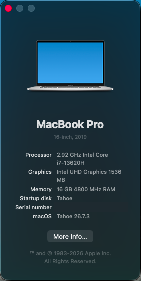
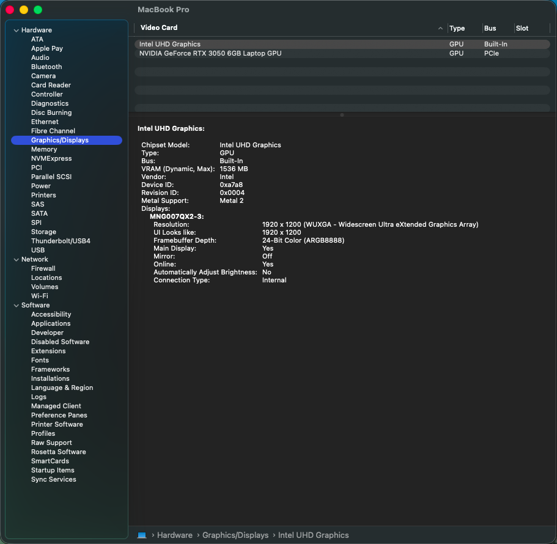
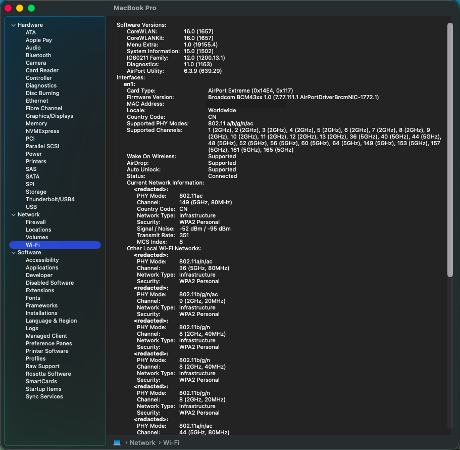

# تشغيل macOS Tahoe على لابتوب Acer Nitro Lite 16 موديل NL16-71G

[English](README.md) | **العربية**

ملف EFI لـ OpenCore وشرح كامل لتشغيل **macOS Tahoe 26** على لابتوب Acer Nitro Lite 16 (موديل N24H6 / NL16-71G) بمعالج Core i7-13620H وكارت RTX 3050 Laptop.

## ملخص

نظام Tahoe شغال كويس كنظام يومي على اللابتوب ده. **كارت Intel UHD شغال بتسريع كامل** (Metal، واجهة ناعمة، فيديو على Chrome) باستخدام [WhateverXe](https://github.com/b00t0x/WhateverXe) مع ثلاث تعديلات صغيرة عملناها. **كارت RTX 3050** شغال بدرايفر [nullmoth](https://github.com/nullmoth/nvidia-macos-driver): بيشغّل منفذ HDMI ومتاح للبرامج ككارت Metal تاني، لكنه مش بيقدر يعرض على شاشة اللابتوب نفسها، لأن الشاشة متوصلة بكارت Intel بس (مافيش MUX switch). الكيبورد والتاتش باد والإضاءة والسماعات والكاميرا والواي فاي والبلوتوث وAirDrop والإيثرنت والـ USB (ومنها USB-C) والبطارية كلها شغالة. السليب والمايك الداخلي وكارت الواي فاي الأصلي مش شغالين (التفاصيل تحت).

اتجرب على: macOS Tahoe 26.7.3 ‏(25G342)، OpenCore 1.0.8، BIOS V1.19، مع Windows 11 على نفس الهارد NVMe ‏512 جيجا.

> **تنبيه:** ده تجميع شخصي متشارك كمرجع. استخدامه على مسؤوليتك، خلي معاك نسخة احتياطية من الهارد وفلاشة إقلاع شغالة، واتوقع إنك هتحتاج تظبطه على جهازك.

## صور

  

كروت الشاشة والواي فاي في System Information

## حالة القطع

| القطعة | الموديل | الحالة | ملاحظات |
|---|---|---|---|
| المعالج | Intel Core i7-13620H ‏(6P + 4E، ‏16 thread) | ✅ شغال | باتش للكيرنل بيشغّل الـ Hyper-Threading، وCpuTopologyRebuild بيرتب أنوية P/E، واسم المعالج بيظهر بـ RestrictEvents. |
| كارت الشاشة المدمج | Intel UHD Graphics ‏8086:A7A8 ‏(Raptor Lake-P) | ✅ شغال | WhateverXe 0.8.3 + WhateverXe Graphics 0.4.4 مع تعديلاتنا (شوف [التعديلات](#التعديلات)). Metal و1536 ميجا. فيديو Safari بيظهر أسود (استخدم Chrome). ممكن يهنج في اختبارات الأداء التقيلة الطويلة جدًا. |
| كارت الشاشة المنفصل | NVIDIA RTX 3050 6GB Laptop ‏(GA107) | ⚠️ جزئي | درايفر nullmoth 3.0. بيشغّل HDMI وكارت Metal تاني للبرامج. مش بيعرض على شاشة اللابتوب (مافيش MUX). مش بيطفي وهو فاضي. |
| شاشة اللابتوب | ‏16 بوصة 1920×1200 eDP | ✅ شغالة | شريط الإضاءة وأزرار Fn شغالين (SSDT-PNLF + BrightnessKeys). |
| HDMI | متوصل بالـ RTX | ⚠️ جزئي | شغال لو الشاشة متوصلة **قبل تشغيل الجهاز**، والفصل والتوصيل بعدها شغال. لو وصلتها بعد ما الجهاز اشتغل من الأول مش بتنور. |
| الواي فاي | الكارت الأصلي (AzureWave AW-XB547NF، ‏Realtek RTL8852BE) اتغير بـ **Broadcom BCM94360NG** | ✅ شغال | SimpleBCM. الكارت الأصلي Realtek ماعندوش درايفر لـ macOS. محتاج ضغطة واحدة للاتصال بالشبكة بعد كل إقلاع. |
| البلوتوث | Broadcom BCM94360NG | ✅ شغال | |
| AirDrop | Broadcom BCM94360NG | ✅ شغال | |
| الكاميرا | مدمجة | ✅ شغالة | |
| منفذ USB-C | | ✅ شغال | |
| الإيثرنت | Realtek RTL8168 | ✅ شغال | RealtekRTL8111. |
| السماعات | Realtek ALC256 | ✅ شغالة | SimpleHDA (لأن Tahoe شال AppleHDA) + AppleALC ‏`alcid=13`. |
| مخرج السماعة | Realtek ALC256 | ❔ لسه ماتجربش | |
| صوت HDMI | RTX 3050 | ❔ لسه ماتجربش | |
| المايك الداخلي | مايكين رقميين على الـ DSP بتاع Intel | ❌ لا | مش متوصلين بكارت الصوت ALC256، ومافيش درايفر للـ DSP على macOS. استخدم مايك USB أو مايك سماعة. |
| الكيبورد | PS/2 | ✅ شغال | VoodooPS2. |
| التاتش باد | I2C HID | ✅ شغال | VoodooI2C (نسخة dortania اللي فيها دعم GPIO لـ Raptor Lake)، بوضع interrupt، والحركات شغالة. |
| USB | | ✅ شغال | المنافذ متعمل لها ماب بـ USBToolBox ‏(`UTBMap.kext`). |
| هارد NVMe | | ✅ شغال | NVMeFix. |
| البطارية | | ✅ شغالة | SMCBatteryManager. حوالي 14.4 وات والجهاز فاضي (الإضاءة حوالي 50%). |
| السليب | | ❌ لا | السليب والصحيان شغالين، لكن الجهاز بيعمل ريستارت بعد حوالي دقيقتين من الصحيان. السليب مقفول، وقفل الغطا بيطفي الجهاز بدل كده (سكريبت lid-shutdown، في ريبو لوحده: اللينك قريب). |

## قبل ما تبدأ

**إعدادات الـ BIOS ‏(V1.19):** Secure Boot مقفول، Fast Boot مقفول، VMD مقفول، Resizable BAR شغال، قائمة F12 شغالة، ووضع الشاشة Optimus. الـ CFG Lock مش بيتقفل من الـ BIOS ده، علشان كده `AppleXcpmCfgLock` شغال في الكونفج.

**هتحتاج:**
- فلاشة (16 جيجا أو أكتر) وطريقة تعمل بيها installer لـ macOS (من ماك تاني، أو بطريقة الـ recovery اللي في [دليل Dortania](https://dortania.github.io/OpenCore-Install-Guide/)).
- SMBIOS خاص بيك. الكونفج اللي هنا الأرقام التسلسلية متشالة منه (`CHANGE-ME`). اعمل أرقام جديدة لـ `MacBookPro16,1` بـ [GenSMBIOS](https://github.com/corpnewt/GenSMBIOS) وحطها في `PlatformInfo > Generic` ‏(`SystemSerialNumber` و`MLB` و`SystemUUID` و`ROM`). ماتشاركش أرقامك مع حد.
- كارت واي فاي Broadcom زي BCM94360NG لو عايز واي فاي داخلي (أو استخدم الإيثرنت أو قطعة USB).
- مساحة فاضية على الهارد لـ macOS (حوالي 100 جيجا أو أكتر)، ونسخة احتياطية كاملة من الويندوز.

## خطوات التسطيب

> **ملاحظة:** إحنا نزلنا Tahoe من نسخة macOS Sequoia كانت متسطبة على نفس اللابتوب (ببرنامج الـ installer بتاع Tahoe)، مش من فلاشة. خطوات الفلاشة اللي تحت ماشية على دليل Dortania وإحنا ماجربناهاش بنفسنا.

1. **اعمل نسخة احتياطية من الويندوز** واتأكد إن BitLocker مقفول (أو إن معاك مفتاح الاسترداد).
2. **فضّي مكان لـ macOS:** من Disk Management في الويندوز صغّر بارتشن الويندوز وسيب المساحة فاضية (unallocated).
3. **ظبط الـ BIOS** زي ما هو مكتوب فوق.
4. **نزّل الـ kexts اللي مش موجودة هنا** (شوف [مش موجود في الريبو](#مش-موجود-في-الريبو)) وحطها في `EFI/OC/Kexts/`.
5. **حط الـ SMBIOS بتاعك** في `EFI/OC/config.plist`.
6. **اعمل فلاشة الـ installer** وانسخ فولدر `EFI` ده على بارتشن الـ EFI بتاع الفلاشة.
7. **اقلع من الفلاشة** (F12)، واختار الـ installer من قائمة OpenCore، وامسح المساحة الفاضية كـ APFS من Disk Utility، ونزّل Tahoe. اللابتوب هيعمل ريستارت كذا مرة، وكل مرة اختار macOS.
8. **نزّل OpenCore على الهارد.** إحنا عملنا بارتشن FAT32 صغير لوحده لـ OpenCore بدل ما نستخدم بارتشن الـ EFI بتاع الويندوز، علشان تحديثات الويندوز ماتبوظش OpenCore، وأي غلطة في OpenCore ماتبوظش الويندوز. بعد كده خلي OpenCore أول اختيار إقلاع في الـ BIOS، والويندوز وmacOS الاتنين بيتفتحوا من قائمة OpenCore.
9. **بعد أول إقلاع:**
   - نزّل باكدج **WhateverXe Graphics** من [إصدارات WhateverXe](https://github.com/b00t0x/WhateverXe/releases) (درايفرات Intel لـ Tahoe)، وبعدين اعمل ريستارت.
   - اختياري، للـ RTX: نزّل درايفر **nullmoth** بالخطوات اللي في [صفحته](https://github.com/nullmoth/nvidia-macos-driver). أول إقلاع بعد تسطيبه ممكن يبقى تقيل أو من غير تسريع، وريستارت تاني بيحلها.
   - وصّل شاشة الـ HDMI قبل ما تشغل الجهاز لو عايز تستخدمها.
10. **اقفل السليب** (`sudo pmset -a disablesleep 1`) لحد ما مشكلة الريستارت بعد السليب تتحل.

## التعديلات

### ملفات ACPI ‏(`EFI/OC/ACPI`)
| الملف | ليه |
|---|---|
| SSDT-PLUG-ALT | إدارة طاقة المعالج (XCPM) على Alder/Raptor Lake. |
| SSDT-EC-USBX | جهاز EC وهمي وخصائص طاقة الـ USB. |
| SSDT-PMC | متحكم إدارة الطاقة (دعم NVRAM). |
| SSDT-RTCAWAC | إصلاح الساعة (RTC). |
| SSDT-GPI0 | بيشغّل متحكم الـ GPIO اللي التاتش باد محتاجه. |
| SSDT-XOSI + تغيير اسم `_OSI` | بيخلي الـ firmware يشغّل الأجزاء الخاصة بالويندوز (التاتش باد). |
| SSDT-PNLF | جهاز الإضاءة (`_UID 19`) علشان التحكم في الإضاءة يشتغل مع WhateverXe. اتكتب مخصوص للابتوب ده. |

### الـ Kexts ‏(`EFI/OC/Kexts`)
| Kext | الإصدار | ليه |
|---|---|---|
| Lilu | 1.7.2 | الأساس اللي باقي الإضافات بتشتغل عليه. |
| VirtualSMC و SMCBatteryManager | 1.3.8 | محاكاة SMC والبطارية. |
| WhateverXe | 0.8.3، **معدّل عندنا** | تسريع Intel UHD على Tahoe. |
| AMFIPass 1.4.1 و AMFIAnchor 0.1.2 + AMFIAnchorInjector | | محتاجينهم لـ WhateverXe وnullmoth على Tahoe. |
| AppleALC | 1.9.8 | كارت الصوت ALC256 ‏(`alcid=13`). |
| SimpleHDA | 1.0.1 | بيرجّع AppleHDA على Tahoe (**مش موجود هنا**، شوف تحت). |
| SimpleBCM | 1.2.1 | واي فاي وبلوتوث Broadcom على Tahoe (**مش موجود هنا**، شوف تحت). |
| RestrictEvents | 1.1.6 | اسم المعالج وإصلاحات تانية. |
| CpuTopologyRebuild | 2.0.2 | ترتيب أنوية P وE. |
| NVMeFix | 1.1.3 | إدارة طاقة الـ NVMe. |
| VoodooPS2Controller | 2.3.7 | الكيبورد. |
| VoodooI2C + VoodooI2CHID | نسخة dortania ‏`6be653a` | التاتش باد. النسخة دي فيها ماب GPIO الصح لـ Raptor Lake، ونسخة 2.9.1 لأ، وده كان بيجبره على وضع polling ويمنع المعالج إنه يرتاح. |
| BrightnessKeys | | أزرار الإضاءة Fn. |
| RealtekRTL8111 | 3.0.0 | الإيثرنت. |
| USBToolBox + UTBMap | | ماب منافذ الـ USB للابتوب ده. |
| XHCI-unsupported | 0.9.2 | دعم متحكم الـ USB. |
| ECEnabler و SMCProcessor | | موجودين بس مقفولين في الكونفج. |

### الـ Boot arguments
| الأمر | ليه |
|---|---|
| `-allow3d -disablegfxfirmware` | ‏WhateverXe: تشغيل التسريع، والشغل من غير firmware الـ GuC. |
| `nvfb=1 nvaccel=1 nvfbheads=4 -nvkmsnosmooth nvfbhotplugpoll=3` | ‏nullmoth: فريم بافر وتسريع الـ RTX، وفحص منفذ HDMI كل 3 ثواني (اللابتوب ده مش بيبلّغ لما تفصل وتوصل الشاشة). |
| `amfi_get_out_of_my_way=0x1 amfi=0x80 ipc_control_port_options=0` | بيخفف فحص توقيع الكود علشان درايفرات الشاشة تشتغل. ده بيقلل حماية النظام. |
| `alcid=13` | ‏layout الـ AppleALC لكارت ALC256. |
| `shda-lang=en` | ‏SimpleHDA. |
| `revcpu=1` | ‏RestrictEvents: إظهار اسم المعالج الحقيقي. |
| `keepsyms=1 debug=0x100` | تقارير kernel panic مقروءة، ومن غير ريستارت أوتوماتيك وقت الـ panic. |

‏SIP: ‏`csr-active-config` = ‏`0x0A43` (مقفول جزئيًا، ودرايفرات الشاشة محتاجاه).

### تعديلاتنا على WhateverXe ‏(`patches/WhateverXe`)
ملف `WhateverXe.kext` اللي هنا نسخة RELEASE من WhateverXe 0.8.3 بالتعديلات دي. لو حدّثت WhateverXe، طبّقها تاني لحد ما تتضاف في النسخة الأصلية.
| التعديل | بيصلح إيه |
|---|---|
| `wex-cmtg.patch` | **شاشة سودا / من غير تسريع.** الـ firmware بتاع Acer بيسيب bit اسمه "CMTG secondary mode" شغال على الـ transcoder بتاع الشاشة (الريجستر 0x60404 = 0x8)، وWhateverXe كان بيرفض يمسك الشاشة إلا لو الريجستر ده بصفر. التعديل بيتجاهل الـ bit ده بس. اتبلّغ للمطور: [b00t0x/WhateverXe#100](https://github.com/b00t0x/WhateverXe/issues/100). |
| `wex-backlight-min.patch` | أقل إضاءة كانت بتطفي الشاشة خالص، دلوقتي بقت خافتة. |
| `wex-hostrps-governor.patch` | من غير firmware الـ GuC كارت الشاشة كان شغال على أعلى تردد طول الوقت. التعديل بيختار التردد حسب شغل الكارت الفعلي، وده قلل استهلاك الطاقة وهو فاضي كتير. اتبلّغ للمطور: [b00t0x/WhateverXe#176](https://github.com/b00t0x/WhateverXe/issues/176). |
| `wex-hostrps-trace.patch` و `wex-gtengine-trace.patch` | عدادات تشخيص للقراية بس استخدمناها وإحنا بنعمل التعديلات اللي فوق. مالهاش أي ضرر. |

## المشاكل اللي قابلتنا واتحلت إزاي

| المشكلة | السبب | الحل |
|---|---|---|
| كارت Intel من غير تسريع والواجهة بطيئة | ‏Tahoe مافيهوش درايفر للكارت ده | ‏WhateverXe + WhateverXe Graphics. |
| الشاشة فضلت سودا مع WhateverXe | ‏bit سايبه الـ firmware ‏(CMTG) على الـ transcoder بتاع eDP | ‏`wex-cmtg.patch`. |
| مافيش تحكم في الإضاءة | مافيش جهاز إضاءة في الـ ACPI | ‏SSDT-PNLF ‏(`_UID 19`) + BrightnessKeys، و`wex-backlight-min.patch` لأقل درجة. |
| الجهاز بيسحب حوالي 27 وات وهو فاضي والمروحة شغالة على طول | التاتش باد على وضع polling (آلاف المقاطعات في الثانية) وكارت الشاشة واقف على أعلى تردد | نسخة VoodooI2C من dortania (من غير polling) + ‏`wex-hostrps-governor.patch`: الاستهلاك وهو فاضي نزل لحوالي 14.4 وات. |
| مافيش صوت على Tahoe | ‏Tahoe شال AppleHDA | ‏SimpleHDA. |
| مافيش واي فاي على Tahoe | دعم Broadcom اتشال من إصدارات macOS الجديدة | ‏SimpleBCM (بعد تركيب BCM94360NG). |
| ‏10 threads بس | ‏macOS بيقفل الـ Hyper-Threading على المعالج ده | باتش للكيرنل + CpuTopologyRebuild. |
| الـ RTX مش بيعرض حاجة على شاشة اللابتوب | مافيش MUX: الشاشة متوصلة بـ Intel بس | استخدام الـ RTX من غير شاشة (البرامج بتختاره ككارت Metal) وعلى HDMI. وضع الـ hybrid التجريبي بتاع nullmoth ‏(`nmhybrid`) اتجرب ولسه مش شغال على اللابتوب ده. |
| شاشة HDMI مش بتنور لو اتوصلت بعد الإقلاع | ‏macOS بيختار كروت الشاشة اللي هيعرض عليها وقت ما بيبدأ | وصّل HDMI قبل تشغيل الجهاز، و`nvfbhotplugpoll=3` بيخلي الفصل والتوصيل بعد كده يشتغل. |
| تحديثات الويندوز ممكن تبوظ الإقلاع | ‏OpenCore كان في بارتشن الـ EFI بتاع الويندوز | بارتشن EFI لوحده لـ OpenCore. |
| الإقلاع بطيء | نسخة DEBUG من OpenCore | التحويل لنسخة RELEASE. |

## مشاكل معروفة

- **السليب:** بيعمل ريستارت بعد حوالي دقيقتين من الصحيان. لسه ماتحلتش، فخلي السليب مقفول.
- **فيديو Safari** بيظهر أسود، وChrome شغال عادي.
- **المايك الداخلي** مش شغال (مايكات على الـ DSP).
- **الـ RTX مش بيطفي** وهو فاضي. قفله عن طريق الـ ACPI خلّى الاستهلاك الكلي يزيد بدل ما يقل.
- **الأحمال التقيلة الطويلة جدًا على كارت الشاشة** (زي اختبار Geekbench GPU كامل) ممكن تهنّج الواجهة على أي كارت من الاتنين. الاستخدام العادي مافيهوش مشكلة.
- **ماتشغلش `killall WindowServer` أبدًا:** فريم بافر Intel مش بيرجع والشاشة بتفضل سودا لحد ما تعمل ريستارت إجباري.
- **الواي فاي** محتاج ضغطة واحدة للاتصال بعد كل إقلاع.

## مش موجود في الريبو

الـ kexts دي فيها كود Apple نفسها، علشان كده مش متوزعة هنا. نزّلها بنفسك وحطها في `EFI/OC/Kexts/`، والكونفج فيه الإعدادات بتاعتها جاهزة.
- **SimpleHDA** 1.0.1: ‏[laobamac/SimpleHDA](https://github.com/laobamac/SimpleHDA)
- **SimpleBCM** 1.2.1: ‏[laobamac/SimpleBCM](https://github.com/laobamac/SimpleBCM)

درايفر nullmoth لكارت NVIDIA بيتسطب جوه macOS (مش في الـ EFI)، نزّله من [الريبو بتاعه](https://github.com/nullmoth/nvidia-macos-driver).

## شكر

التجميع ده قايم على شغل ناس تانية: [Acidanthera](https://github.com/acidanthera) ‏(OpenCore وLilu وVirtualSMC وAppleALC وغيرهم)، و[b00t0x](https://github.com/b00t0x) ‏(WhateverXe وAMFIAnchor وCpuTopologyRebuild)، و[nullmoth](https://github.com/nullmoth/nvidia-macos-driver)، و[laobamac](https://github.com/laobamac) ‏(SimpleHDA وSimpleBCM)، و[dhinakg](https://github.com/dhinakg) ‏(AMFIPass وUSBToolBox)، وفريق [VoodooI2C](https://github.com/VoodooI2C/VoodooI2C)، وMieze ‏(RealtekRTL8111)، وأدلة [Dortania](https://dortania.github.io/)، و[kitsuneislife](https://github.com/kitsuneislife/Acer-Nitro-V15-ANV15-51-Hackintosh) على الـ EFI اللي بدأنا منه. رُخص الملفات الموجودة مكتوبة في [THIRD-PARTY-NOTICES.md](THIRD-PARTY-NOTICES.md).

## الرخصة

الشرح وملفات التعديلات في الريبو ده تحت [رخصة MIT](LICENSE). الملفات اللي في `EFI/` كل واحد ليه رخصته (شوف [THIRD-PARTY-NOTICES.md](THIRD-PARTY-NOTICES.md)).

## الدعم

لو الشرح أو الـ EFI وفّر عليك وقت، ممكن تعزمني على قهوة:

