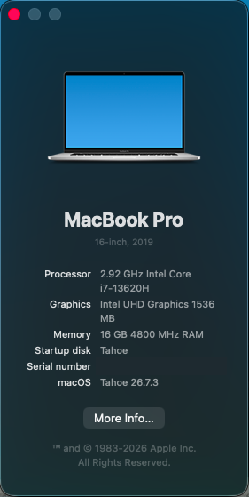
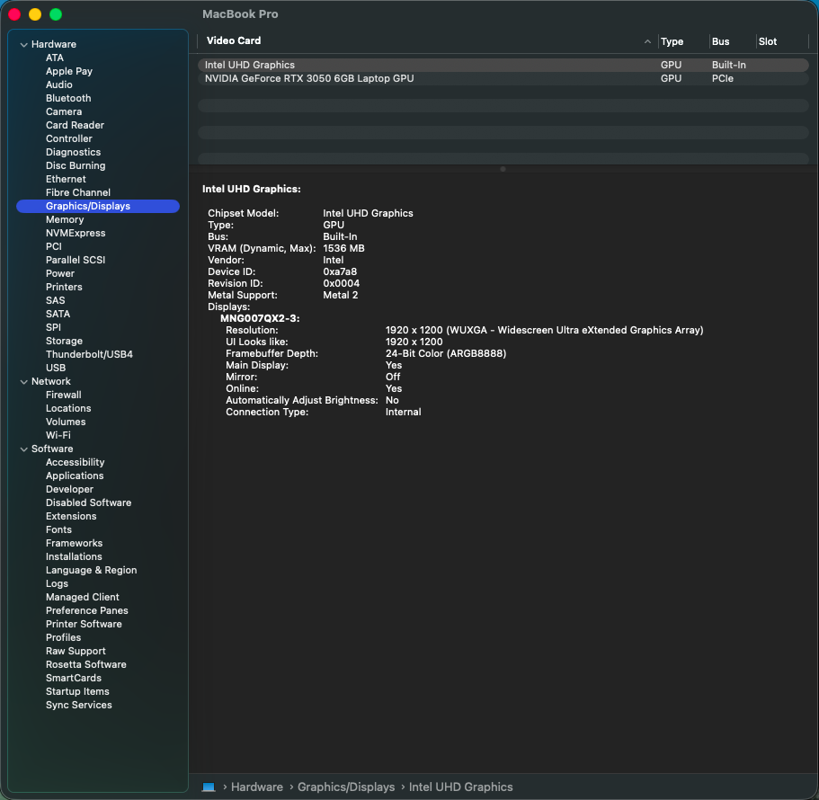
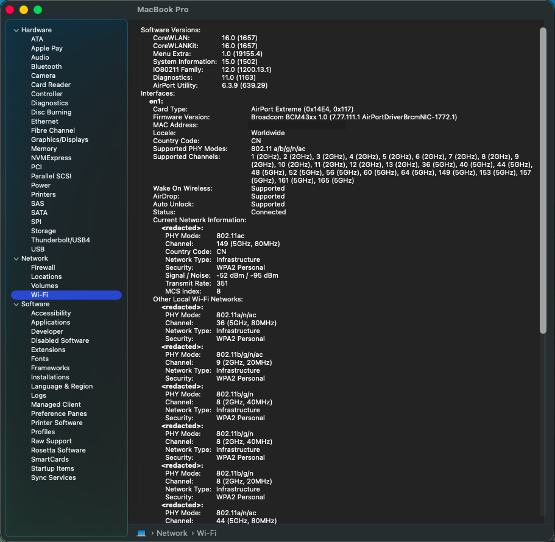

# macOS Tahoe on the Acer Nitro Lite 16 (NL16-71G)

**English** | [العربية](README.ar.md)

OpenCore EFI and notes for running **macOS Tahoe 26** on the Acer Nitro Lite 16 (model N24H6, NL16-71G) with the Core i7-13620H and RTX 3050 Laptop GPU.

## Summary

Tahoe runs well as a daily system on this laptop. The **Intel UHD Graphics are fully accelerated** (Metal, smooth desktop, video in Chrome) thanks to [WhateverXe](https://github.com/b00t0x/WhateverXe) with three small local patches. The **RTX 3050** works through the community [nullmoth](https://github.com/nullmoth/nvidia-macos-driver) driver: it drives the HDMI port and is available to apps as a second Metal GPU, but it cannot draw the laptop's own screen, because the panel is wired only to the Intel GPU (there is no MUX switch). Keyboard, trackpad, brightness, speakers, webcam, Wi-Fi, Bluetooth, AirDrop, Ethernet, USB (including USB-C) and battery all work. Sleep, the internal microphone and the original Wi-Fi card do not (details below).

Tested on: macOS Tahoe 26.7.3 (25G342), OpenCore 1.0.8, BIOS V1.19, dual-boot with Windows 11 on one 512 GB NVMe.

> **Disclaimer:** this is a personal build shared as a reference. Use it at your own risk, keep a backup of your disk and a working USB boot stick, and expect to adapt it to your own machine.

## Screenshots

  

Graphics and Wi-Fi in System Information

## Hardware status

| Part | Model | Status | Notes |
|---|---|---|---|
| CPU | Intel Core i7-13620H (6P + 4E, 16 threads) | ✅ Works | Kernel patch forces Hyper-Threading on; CpuTopologyRebuild arranges P/E cores; CPU name shown via RestrictEvents. |
| Integrated GPU | Intel UHD Graphics, 8086:A7A8 (Raptor Lake-P) | ✅ Works | WhateverXe 0.8.3 + WhateverXe Graphics 0.4.4, with local patches (see [What we changed](#what-we-changed)). Metal, 1536 MB. Safari video plays black (use Chrome). Can hang under very long, heavy GPU benchmarks. |
| Discrete GPU | NVIDIA RTX 3050 6 GB Laptop (GA107) | ⚠️ Partial | nullmoth 3.0 driver. Drives HDMI and is a second Metal device for apps. Cannot drive the internal panel (no MUX). Cannot be powered off when idle. |
| Internal display | 16" 1920×1200 eDP | ✅ Works | Brightness slider and Fn keys work (SSDT-PNLF + BrightnessKeys). |
| HDMI | Wired to the RTX | ⚠️ Partial | Works if the monitor is connected **before power-on**; unplug/replug during that session works. Plugging in after a cold boot does not light the monitor. |
| Wi-Fi | Stock card (AzureWave AW-XB547NF, Realtek RTL8852BE) replaced with **Broadcom BCM94360NG** | ✅ Works | SimpleBCM. The stock Realtek card has no macOS driver. Needs one click to join the network after each boot. |
| Bluetooth | Broadcom BCM94360NG | ✅ Works | |
| AirDrop | Broadcom BCM94360NG | ✅ Works | |
| Webcam | Built-in | ✅ Works | |
| USB-C port | | ✅ Works | |
| Ethernet | Realtek RTL8168 | ✅ Works | RealtekRTL8111. |
| Speakers | Realtek ALC256 | ✅ Works | SimpleHDA (Tahoe removed AppleHDA) + AppleALC `alcid=13`. |
| Headphone jack | Realtek ALC256 | ❔ Not tested | |
| HDMI audio | RTX 3050 | ❔ Not tested | |
| Internal microphone | 2 digital mics on the Intel audio DSP | ❌ No | Not connected to the ALC256 codec; there is no macOS driver for the DSP. Use a USB or headset mic. |
| Keyboard | PS/2 | ✅ Works | VoodooPS2. |
| Trackpad | I2C HID | ✅ Works | VoodooI2C (dortania build with Raptor Lake GPIO support), interrupt mode, gestures. |
| USB | | ✅ Works | Ports mapped with USBToolBox (`UTBMap.kext`). |
| NVMe SSD | | ✅ Works | NVMeFix. |
| Battery | | ✅ Works | SMCBatteryManager. About 14.4 W at idle with the desktop open (brightness about 50 %). |
| Sleep | | ❌ No | Sleep and wake work, but the system restarts about 2 minutes after waking. Sleep is disabled; closing the lid shuts down instead (lid-shutdown, separate repo: link coming). |

## Before you start

**BIOS (V1.19) settings used:** Secure Boot off, Fast Boot off, VMD off, Resizable BAR on, F12 boot menu on, display mode Optimus. CFG Lock cannot be turned off in this BIOS, so `AppleXcpmCfgLock` is enabled in the config.

**You need:**
- A USB stick (16 GB or more) and a way to make a macOS installer (from another Mac, or the recovery image method in the [Dortania guide](https://dortania.github.io/OpenCore-Install-Guide/)).
- Your own SMBIOS. The config in this repo has the serial numbers removed (`CHANGE-ME`). Generate new ones for `MacBookPro16,1` with [GenSMBIOS](https://github.com/corpnewt/GenSMBIOS) and fill in `PlatformInfo > Generic` (`SystemSerialNumber`, `MLB`, `SystemUUID`, `ROM`). Never share yours.
- A Broadcom Wi-Fi card such as the BCM94360NG if you want built-in Wi-Fi (or use Ethernet / a USB adapter).
- Free space on the SSD for macOS (about 100 GB or more), and a full Windows backup.

## Install steps

> **Note:** we installed Tahoe from an existing macOS Sequoia install on the same laptop (with the Tahoe installer app), not from a USB stick. The USB steps below follow the Dortania guide and were not tested by us.

1. **Back up Windows** and check that BitLocker is off (or that you have the recovery key).
2. **Make room for macOS:** in Windows Disk Management, shrink the Windows partition and leave the free space unallocated.
3. **Set the BIOS** as listed above.
4. **Download the kexts that are not included here** (see [Not included](#not-included)) and put them in `EFI/OC/Kexts/`.
5. **Add your SMBIOS** to `EFI/OC/config.plist`.
6. **Make the installer USB** and copy this `EFI` folder to the USB stick's EFI partition.
7. **Boot from USB** (F12), choose the installer in the OpenCore menu, erase the free space as an APFS volume in Disk Utility, and install Tahoe. The laptop restarts several times; keep choosing the macOS entry.
8. **Install OpenCore on the SSD.** We created a small separate FAT32 partition for OpenCore instead of using the Windows EFI partition, so a Windows update cannot break OpenCore and a bad OpenCore change cannot break Windows. Then set OpenCore as the first boot entry in the BIOS; Windows and macOS are both started from the OpenCore menu.
9. **After the first boot:**
   - Install the **WhateverXe Graphics** package from the [WhateverXe releases](https://github.com/b00t0x/WhateverXe/releases) (Intel graphics stack for Tahoe), then restart.
   - Optional, for the RTX: install the **nullmoth** driver following [its own instructions](https://github.com/nullmoth/nvidia-macos-driver). The first boot after installing it can be slow or unaccelerated; a second restart fixes it.
   - Connect the HDMI monitor before powering on if you want to use it.
10. **Disable sleep** (`sudo pmset -a disablesleep 1`) until the sleep restart is solved.

## What we changed

### ACPI (`EFI/OC/ACPI`)
| File | Why |
|---|---|
| SSDT-PLUG-ALT | CPU power management (XCPM) on Alder/Raptor Lake. |
| SSDT-EC-USBX | Fake EC device and USB power properties. |
| SSDT-PMC | Power management controller (NVRAM support). |
| SSDT-RTCAWAC | Real-time clock fix. |
| SSDT-GPI0 | Enables the GPIO controller the trackpad needs. |
| SSDT-XOSI + `_OSI` rename | Makes the firmware enable the Windows code paths (trackpad). |
| SSDT-PNLF | Backlight device (`_UID 19`) so brightness control works with WhateverXe. Hand-written for this laptop. |

### Kexts (`EFI/OC/Kexts`)
| Kext | Version | Why |
|---|---|---|
| Lilu | 1.7.2 | Base for the other plugins. |
| VirtualSMC, SMCBatteryManager | 1.3.8 | SMC emulation, battery. |
| WhateverXe | 0.8.3, **locally patched** | Intel UHD acceleration on Tahoe. |
| AMFIPass 1.4.1, AMFIAnchor 0.1.2 + AMFIAnchorInjector | | Needed by WhateverXe and nullmoth on Tahoe. |
| AppleALC | 1.9.8 | ALC256 codec (`alcid=13`). |
| SimpleHDA | 1.0.1 | Brings back AppleHDA on Tahoe (**not included**, see below). |
| SimpleBCM | 1.2.1 | Broadcom Wi-Fi/Bluetooth on Tahoe (**not included**, see below). |
| RestrictEvents | 1.1.6 | CPU name, misc fixes. |
| CpuTopologyRebuild | 2.0.2 | P-core/E-core topology. |
| NVMeFix | 1.1.3 | NVMe power management. |
| VoodooPS2Controller | 2.3.7 | Keyboard. |
| VoodooI2C + VoodooI2CHID | dortania build `6be653a` | Trackpad. This build has the correct GPIO map for Raptor Lake; the 2.9.1 release does not, which forced polling mode and kept the CPU from idling. |
| BrightnessKeys | | Fn brightness keys. |
| RealtekRTL8111 | 3.0.0 | Ethernet. |
| USBToolBox + UTBMap | | USB port map for this laptop. |
| XHCI-unsupported | 0.9.2 | USB controller support. |
| ECEnabler, SMCProcessor | | Included but disabled in the config. |

### Boot arguments
| Argument | Why |
|---|---|
| `-allow3d -disablegfxfirmware` | WhateverXe: enable acceleration, run without GuC firmware. |
| `nvfb=1 nvaccel=1 nvfbheads=4 -nvkmsnosmooth nvfbhotplugpoll=3` | nullmoth: RTX framebuffer and acceleration; check the HDMI port every 3 s (this laptop never reports re-plugging). |
| `amfi_get_out_of_my_way=0x1 amfi=0x80 ipc_control_port_options=0` | Loosens code-signing checks so the graphics drivers load. This lowers system security. |
| `alcid=13` | AppleALC layout for the ALC256. |
| `shda-lang=en` | SimpleHDA. |
| `revcpu=1` | RestrictEvents: show the real CPU name. |
| `keepsyms=1 debug=0x100` | Readable kernel panic reports, no automatic reboot on panic. |

SIP: `csr-active-config` = `0x0A43` (partly disabled, required by the graphics drivers).

### Local WhateverXe patches (`patches/WhateverXe`)
The included `WhateverXe.kext` is a RELEASE build of WhateverXe 0.8.3 with these patches. If you update WhateverXe, re-apply them until upstream includes them.
| Patch | What it fixes |
|---|---|
| `wex-cmtg.patch` | **Black panel / no acceleration.** Acer's firmware leaves a "CMTG secondary mode" bit set on the panel's transcoder (register 0x60404 = 0x8). WhateverXe refused to take over the panel unless that register was 0. The patch ignores that one bit. Reported upstream: [b00t0x/WhateverXe#100](https://github.com/b00t0x/WhateverXe/issues/100). |
| `wex-backlight-min.patch` | Lowest brightness turned the panel fully black; now it is dim. |
| `wex-hostrps-governor.patch` | Without GuC firmware the GPU stayed at maximum frequency all the time. The patch picks the frequency from actual GPU activity, which cut idle power a lot. Reported upstream: [b00t0x/WhateverXe#176](https://github.com/b00t0x/WhateverXe/issues/176). |
| `wex-hostrps-trace.patch`, `wex-gtengine-trace.patch` | Read-only diagnostic counters used while developing the above. Harmless. |

## Problems we hit and how we solved them

| Problem | Cause | Fix |
|---|---|---|
| Intel GPU not accelerated, slow desktop | Tahoe has no driver for this GPU | WhateverXe + WhateverXe Graphics. |
| Panel stayed black with WhateverXe | Firmware leftover bit (CMTG) on the eDP transcoder | `wex-cmtg.patch`. |
| No brightness control | No backlight device in ACPI | SSDT-PNLF (`_UID 19`) + BrightnessKeys; `wex-backlight-min.patch` for the lowest step. |
| Idle power about 27 W, fan always on | Trackpad in polling mode (thousands of interrupts per second) and GPU stuck at max frequency | Dortania VoodooI2C build (no polling) + `wex-hostrps-governor.patch`: idle dropped to about 14.4 W. |
| No sound on Tahoe | Tahoe removed AppleHDA | SimpleHDA. |
| No Wi-Fi on Tahoe | Broadcom support was removed from recent macOS | SimpleBCM (after swapping in a BCM94360NG). |
| Only 10 threads | macOS disables Hyper-Threading on this CPU | Kernel patch + CpuTopologyRebuild. |
| RTX cannot show anything on the laptop screen | No MUX: the panel is wired only to Intel | Use the RTX headless (apps choose it as a Metal device) and on HDMI. nullmoth's experimental hybrid mode (`nmhybrid`) was tested and does not work on this laptop yet. |
| HDMI monitor stays dark when plugged in after boot | macOS picks its display GPUs at startup | Connect HDMI before powering on; `nvfbhotplugpoll=3` makes replugging work afterwards. |
| Windows updates could break the boot loader | OpenCore in the Windows EFI partition | Separate EFI partition for OpenCore. |
| Slow boot | OpenCore DEBUG build | Switched to the RELEASE build. |

## Known issues

- **Sleep:** restarts about 2 minutes after waking. Unsolved; keep sleep disabled.
- **Safari video** plays black; Chrome works.
- **Internal microphone** does not work (DSP microphones).
- **RTX cannot be powered off** at idle. Turning it off through ACPI made total power go up, not down.
- **Very long, heavy GPU loads** (for example a full Geekbench GPU run) can freeze the desktop on either GPU. Normal use is fine.
- **Never run `killall WindowServer`:** the Intel framebuffer does not come back and the screen stays black until a forced restart.
- **Wi-Fi** needs one click to join after each boot.

## Not included

These kexts contain Apple's own code, so they are not redistributed here. Download them yourself and put them in `EFI/OC/Kexts/`; the config already has their entries.
- **SimpleHDA** 1.0.1: [laobamac/SimpleHDA](https://github.com/laobamac/SimpleHDA)
- **SimpleBCM** 1.2.1: [laobamac/SimpleBCM](https://github.com/laobamac/SimpleBCM)

The nullmoth NVIDIA driver is installed into macOS (not into the EFI); get it from [its repository](https://github.com/nullmoth/nvidia-macos-driver).

## Credits

This build stands on other people's work: [Acidanthera](https://github.com/acidanthera) (OpenCore, Lilu, VirtualSMC, AppleALC and more), [b00t0x](https://github.com/b00t0x) (WhateverXe, AMFIAnchor, CpuTopologyRebuild), [nullmoth](https://github.com/nullmoth/nvidia-macos-driver), [laobamac](https://github.com/laobamac) (SimpleHDA, SimpleBCM), [dhinakg](https://github.com/dhinakg) (AMFIPass, USBToolBox), the [VoodooI2C](https://github.com/VoodooI2C/VoodooI2C) team, Mieze (RealtekRTL8111), the [Dortania](https://dortania.github.io/) guides, and [kitsuneislife](https://github.com/kitsuneislife/Acer-Nitro-V15-ANV15-51-Hackintosh) for the starting EFI. Licenses for the included files are listed in [THIRD-PARTY-NOTICES.md](THIRD-PARTY-NOTICES.md).

## License

The documentation and the patch files in this repository are under the [MIT License](LICENSE). Files in `EFI/` keep their own licenses (see [THIRD-PARTY-NOTICES.md](THIRD-PARTY-NOTICES.md)).

## Support

If this guide or EFI saved you time, you can buy me a coffee:

